

  <picture>
    <source media="(max-width: 600px)" srcset="assets/banner-mobile.svg">
    
  </picture>

 

  Full Stack Developer building enterprise web applications with Java, Spring Boot and Angular. 
  Product-minded: I care as much about why a feature exists as about how it's built.

  <picture><source media="(max-width: 600px) and (prefers-color-scheme: dark)" srcset="assets/summary-mobile-dark.svg"><source media="(max-width: 600px)" srcset="assets/summary-mobile-light.svg"><source media="(prefers-color-scheme: dark)" srcset="assets/summary-dark.svg">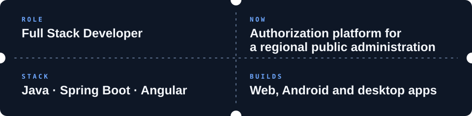</picture>

 

## <picture><source media="(prefers-color-scheme: dark)" srcset="assets/what-i-work-on-dark.svg">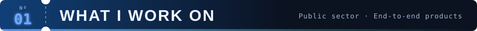</picture>

- **On the job:** Angular and Node.js modules in a large multi-team codebase, Spring Boot microservices with MySQL.
- **Quality and delivery:** Jest unit tests and a CI/CD pipeline with Jenkins, Maven, SonarQube and Docker.
- **Outside work:** complete products, end to end.

 

## <picture><source media="(prefers-color-scheme: dark)" srcset="assets/featured-projects-dark.svg">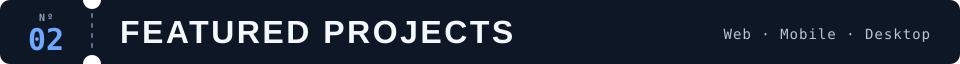</picture>

<table>
  <tr>
    <td width="28%" valign="top"> <b>JWT-Angular</b> Web client  <a href="https://github.com/jortegadmr/jwt-angular">Code</a>  </td>
    <td valign="top"> Angular 18 client with JWT authentication: reactive login, Bearer token interceptor and server-side rendering.      </td>
  </tr>
  <tr><td colspan="2" align="center"><picture><source media="(prefers-color-scheme: dark)" srcset="assets/divider-dark.svg"></picture></td></tr>
  <tr>
    <td width="28%" valign="top"> <b>QueueQuest</b> Mobile and web  <a href="https://github.com/jortegadmr/queue-quest">Code</a> · <a href="https://queuequest-a1303.web.app">Live demo</a>  </td>
    <td valign="top"> Queue and booking app with a gamified layer: scan a QR code, see your position in real time and play while you wait.      </td>
  </tr>
  <tr><td colspan="2" align="center"><picture><source media="(prefers-color-scheme: dark)" srcset="assets/divider-dark.svg"></picture></td></tr>
  <tr>
    <td width="28%" valign="top"> <b>Comtax</b> Android  <a href="https://github.com/jortegadmr/comtax">Code</a>  </td>
    <td valign="top"> Envelope budgeting for Android. Works fully offline, with PIN lock and CSV export.       </td>
  </tr>
  <tr><td colspan="2" align="center"><picture><source media="(prefers-color-scheme: dark)" srcset="assets/divider-dark.svg"></picture></td></tr>
  <tr>
    <td width="28%" valign="top"> <b>Atelier</b> Desktop  <a href="https://github.com/jortegadmr/Atelieer">Code</a>  </td>
    <td valign="top"> Desktop app for Windows and macOS to develop scripts and story ideas for a TV series.      </td>
  </tr>
</table>

 

## <picture><source media="(prefers-color-scheme: dark)" srcset="assets/creative-web-lab-dark.svg">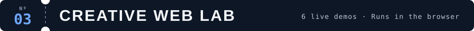</picture>

Small interactive experiments that run entirely in the browser: GPU simulations, generative sound and light. TypeScript and Vite, no backend, deployed on GitHub Pages.

  <picture>
    <source media="(max-width: 600px) and (prefers-color-scheme: dark)" srcset="assets/marquee-mobile-dark.svg">
    <source media="(max-width: 600px)" srcset="assets/marquee-mobile-light.svg">
    <source media="(prefers-color-scheme: dark)" srcset="assets/marquee-dark.svg">
    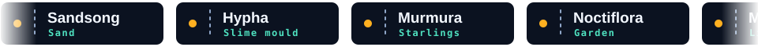
  </picture>

<table>
  <tr>
    <td width="50%" valign="top">
      <a href="https://jortegadmr.github.io/sandsong/">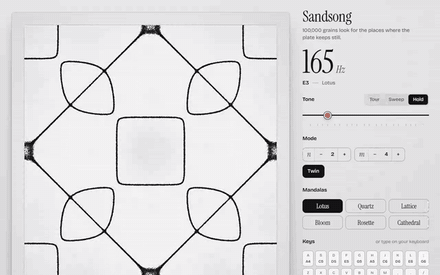</a>
      
<b>Sandsong</b> About 100k grains of sand settle into Chladni figures. <a href="https://jortegadmr.github.io/sandsong/">Live demo</a> · <a href="https://github.com/jortegadmr/sandsong">Code</a> WebGL2 · GLSL · Web Audio

    </td>
    <td width="50%" valign="top">
      <a href="https://jortegadmr.github.io/hypha/">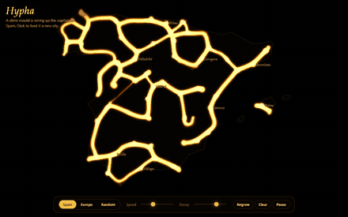</a>
      
<b>Hypha</b> Slime mould grows networks between Spanish capitals. <a href="https://jortegadmr.github.io/hypha/">Live demo</a> · <a href="https://github.com/jortegadmr/hypha">Code</a> WebGL2 · GLSL · TypeScript

    </td>
  </tr>
  <tr>
    <td width="50%" valign="top">
      <a href="https://jortegadmr.github.io/murmura/">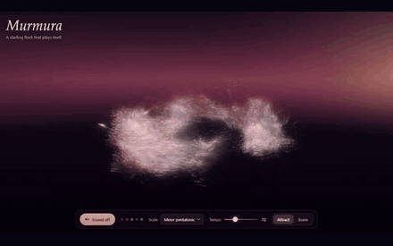</a>
      
<b>Murmura</b> GPU starling murmuration that plays a generative synth. <a href="https://jortegadmr.github.io/murmura/">Live demo</a> · <a href="https://github.com/jortegadmr/murmura">Code</a> three.js · GPGPU · Web Audio

    </td>
    <td width="50%" valign="top">
      <a href="https://jortegadmr.github.io/noctiflora/">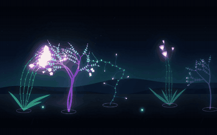</a>
      
<b>Noctiflora</b> Bioluminescent garden that grows toward the light you paint. <a href="https://jortegadmr.github.io/noctiflora/">Live demo</a> · <a href="https://github.com/jortegadmr/noctiflora">Code</a> Canvas 2D · Custom bloom · TypeScript

    </td>
  </tr>
  <tr>
    <td width="50%" valign="top">
      <a href="https://jortegadmr.github.io/mandalux/">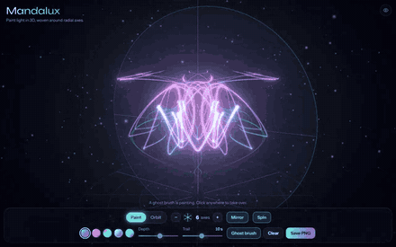</a>
      
<b>Mandalux</b> 3D light painting with radial symmetry and neon bloom. <a href="https://jortegadmr.github.io/mandalux/">Live demo</a> · <a href="https://github.com/jortegadmr/mandalux">Code</a> three.js · UnrealBloom · TypeScript

    </td>
    <td width="50%" valign="top">
      <a href="https://jortegadmr.github.io/epichord/">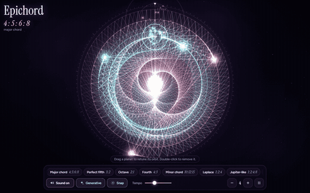</a>
      
<b>Epichord</b> Pocket solar system: resonant orbits play chords. <a href="https://jortegadmr.github.io/epichord/">Live demo</a> · <a href="https://github.com/jortegadmr/epichord">Code</a> Canvas 2D · Web Audio · TypeScript

    </td>
  </tr>
</table>

 

## <picture><source media="(prefers-color-scheme: dark)" srcset="assets/stack-dark.svg">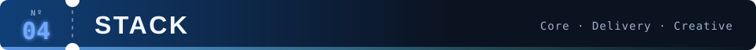</picture>

| | |
|---|---|
| **Core** |       |
| **Delivery** |       |
| **Creative web** |      |
| **Also** |    |
